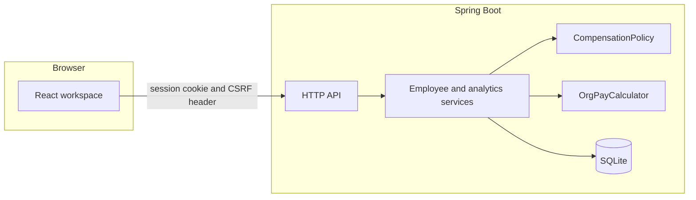
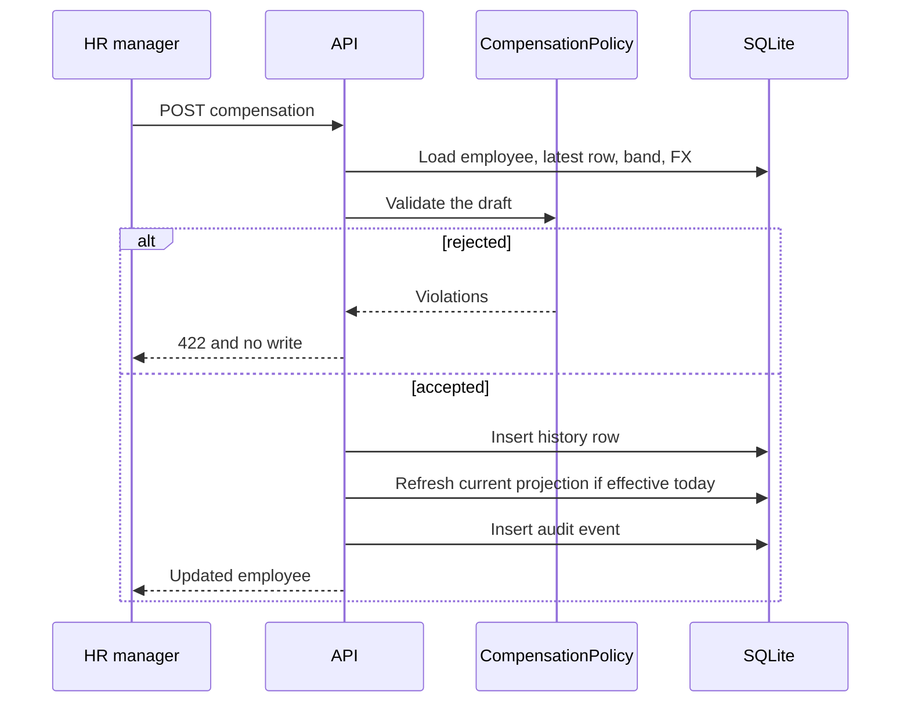

# Architecture

ACME Compensation is one Spring Boot process and a React UI. SQLite is the system of record. The UI is a client of the API; it does not enforce pay rules.

## Why this shape

The assessment allows a relational database and a React UI, and asks for judgment rather than a large platform. SQLite in a single file is enough for 10,000 employees, starts with no separate database install, and matches running one HR process. JDBC is used instead of an ORM so money stays a decimal string, batch seeding stays obvious, and sort columns stay an allowlist instead of a framework feature that might interpolate them.

## Modules

- `domain` holds enums, the band catalog, money parsing, the compensation policy, pay snapshots, and the org-pay calculator. These types do not open a connection. Unit tests call them directly.
- `repo` is SQL. Writes are parameterized. The employee list is one joined query, not a person query plus a pay query per row.
- `service` is the transaction boundary. Creating a person, appending pay, refreshing current pay, and writing the audit row commit or roll back together.
- `web` is JSON, status codes, and security filters.
- `seed` builds a deterministic workforce and inserts it only when the employee table is empty.

## Pay model

`compensation_record` is append-only and stores the band min, mid, max, compa-ratio, band position, and USD amounts as they were on that day. Later band or FX edits do not rewrite history.

`current_compensation` is a projection: one row per employee, the winner among records effective on or before today. The dashboard and the directory read this table. It can be rebuilt from history.

## Authentication

The UI calls `GET /api/health` to receive the CSRF cookie, then posts credentials. Spring Security keeps an HTTP-only session. The API returns JSON 401 responses and does not redirect, so the React app can send the user to its own login screen.

## Running

In development the Vite server proxies `/api` to port 8080, so the browser sees a single origin. A production build copies the UI into Spring Boot’s static resources and the same process serves both.
